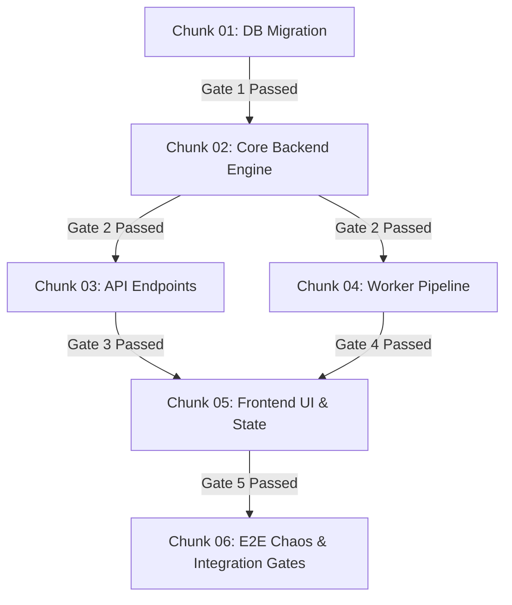

# 🎼 MASTER ORCHESTRATED HARDENED PLANNING PIPELINE (`orchestrated-hardened-plan`)
### _(Monolithic Hardening × Decomposed Execution × Supervised Orchestration DAG)_

---

## 🎯 ARCHITECTURAL PHILOSOPHY: "PLAN AS ONE, EXECUTE AS MANY"

Jab systems complex hote hain, AI do tarah se fail hota hai:
1. **Premature Decomposition Failure:** Agar planning ke shuru mein hi plan ko tukdo mein baant diya jaye, toh har sub-plan alag bubble mein banega. Database schema change ka impact worker aur UI par kya hoga, woh cross-cutting flaws koi auditor nahi pakad payega.
2. **Monolithic Execution Failure:** Agar 5-round hardened 3000-line ka single plan kisi AI agent ko de diya jaye execute karne ke liye, toh agent context window exhaustion aur cognitive overload ke chalte critical edge-cases, locks, aur timeouts miss kar dega.

**The Solution:**
> **Plan and Audit Monolithically** (Poora system ek context mein dekho taaki zero cross-cutting blindspots rahein).  
> **Decompose and Execute Atomically** (Hardening ke baad exact contracts ke sath plan ko isolated execution chunks mein baanto aur supervise karo).

---

## ⚡ OPERATIONAL STATE MACHINE (The 4-Phase Lifecycle)

```text
┌─────────────────────────────────────────────────────────────────────────────┐
│ INPUT: Feature Name (e.g. "Realtime Sync") OR Existing Draft Plan            │
└──────────────────────────────────────┬──────────────────────────────────────┘
                                       │
                                       ▼
┌─────────────────────────────────────────────────────────────────────────────┐
│ PHASE 1: MONOLITHIC INVERSION DRAFTING (anti-fragile-planning)              │
│ • Step 0: CBM (AST symbols & callers) × CRG (Blast radius & affected flows) │
│ • 5 Chaos Vectors & Inversion Pre-Mortem Matrix                             │
│ • Produces: master-plan-v1.0.md (Full holistic system blueprint)            │
└──────────────────────────────────────┬──────────────────────────────────────┘
                                       │
                                       ▼
┌─────────────────────────────────────────────────────────────────────────────┐
│ PHASE 2: 5-ROUND ADVERSARIAL HARDENING LOOP (auto-hardened-plan)             │
│ • 5 Sequential Flash Subagents with 0 prior chat memory                     │
│ • Universal Forensic Failure Audit across the ENTIRE system                 │
│ • Physical Proof Gate: Exact line citations (#L..), zero hallucinations     │
│ • Lead Architect patches master-plan.md on disk: v1.0 ➔ v2.0 ➔ ... ➔ v6.0   │
│ • Terminates ONLY when: Round >= 5 AND Critical/Fatal Flaws == 0            │
│ • Produces: master-plan-CERTIFIED.md                                        │
└──────────────────────────────────────┬──────────────────────────────────────┘
                                       │
                                       ▼
┌─────────────────────────────────────────────────────────────────────────────┐
│ PHASE 3: INTELLIGENT SRE DECOMPOSITION (Post-Hardening Slicing)             │
│ • Lead Architect slices master-plan-CERTIFIED.md into atomic chunks         │
│ • Har chunk ke paas strict boundary, dedicated verification gate, aur       │
│   explicit Input/Output Contract hoga                                       │
│ • Generates:                                                                │
│   ├── chunks/chunk-01-[scope].md                                            │
│   ├── chunks/chunk-02-[scope].md                                            │
│   └── chunks/chunk-0N-[scope].md                                            │
└──────────────────────────────────────┬──────────────────────────────────────┘
                                       │
                                       ▼
┌─────────────────────────────────────────────────────────────────────────────┐
│ PHASE 4: SUPERVISED ORCHESTRATION MANIFEST (The Execution DAG)              │
│ • Generates: execution-manifest.md                                          │
│ • Dependency Graph: Kaunsa chunk kiske baad chalega (Sequential vs Parallel)│
│ • Pre-Condition Gates: Check before starting next agent                     │
│ • Post-Condition Proof Gates: bash / curl / SQL assertions to verify        │
│ • Circuit Breakers & Rollback triggers agar koi chunk fail ho jaye          │
└─────────────────────────────────────────────────────────────────────────────┘
```

---

## 🔬 PHASE 1: MONOLITHIC INVERSION DRAFTING

Pehle poore feature ka ek unified blueprint draft hota hai using `anti-fragile-planning`:
1. **Mandatory Step 0 Investigation:**
   - CBM: `search_graph` se symbols aur `trace_path` se inbound callers identify karo.
   - CRG: `get_impact_radius_tool` se 2-hop blast radius aur `get_affected_flows_tool` se broken flows nikalo.
2. **The 5 Chaos Vectors:**
   - Vector 1: Concurrency, Locks & Temporal Drift (`structuredClone`, row locks, atomic transactions).
   - Vector 2: Process Lifecycle & Resource Entropy (Dual-tier timeouts, detached kill escalators, `.unref()`).
   - Vector 3: Semantic Validation vs Format Illusion (AI hallucinations, poison-pill arrays).
   - Vector 4: Client State Isolation & Navigation Safety (Context reset, unmounted guards).
   - Vector 5: Self-Documenting Resilience (Chesterton's Fence comments).
3. **Master Blueprint:** Target files, database schema, API contracts, worker pipelines, aur UI state ko ek single document (`master-plan.md`) mein assemble kiya jata hai.

---

## 🥊 PHASE 2: 5-ROUND SEQUENTIAL ADVERSARIAL HARDENING

Poore master plan ko 5 distinct Flash subagents attack karte hain:
- **Round 1 (Foundational Failure):** Core logic deadlocks, fatal architectural flaws.
- **Round 2 (Temporal Drift & Race Conditions):** Concurrency, DB locks, cache invalidations.
- **Round 3 (Chaos, Scale & Resource Poisoning):** OOM vectors, unbounded queues, missing indexes.
- **Round 4 (Anti-Overengineering & Pruning):** Musk 5-step pruning, speculative layers delete karna.
- **Round 5 (Final SRE Gatekeeper):** Verification gates, assert commands, complete certification.

> **Convergence Rule:** Loop tab tak terminate nahi hoga jab tak minimum 5 rounds complete na ho aur `Critical Flaws == 0` certify na ho jaye.  
> Output: `master-plan-CERTIFIED.md`.

---

## ✂️ PHASE 3: POST-HARDENING DECOMPOSITION (Chunk Slicing)

Jab master plan 100% hardened ho jata hai, tab Lead Architect usko **atomic, independent execution slices** mein break karta hai. Har chunk ek standalone file banta hai folder `plans/chunks/` ke andar:

```text
plans/
├── master-plan-CERTIFIED.md
├── execution-manifest.md
└── chunks/
    ├── chunk-01-database-migrations.md
    ├── chunk-02-core-engine-backend.md
    ├── chunk-03-api-and-routes.md
    ├── chunk-04-worker-pipeline.md
    ├── chunk-05-frontend-ui-and-state.md
    └── chunk-06-e2e-chaos-verification.md
```

### Anatomy of an Atomic Execution Chunk (`chunk-XX.md`):

Har chunk file ka format strictly yeh hoga taaki executing agent ko zero ambiguity ho:

```markdown
# CHUNK-01: [Chunk Name]

## 1. Scope & Boundaries
- Target Files to CREATE / MODIFY / DELETE (with exact paths).
- Max LOC impact.
- What this chunk DOES NOT touch (Explicit out-of-scope).

## 2. Inbound Dependencies (Prerequisites)
- Files, migrations, or npm packages that MUST exist before this chunk begins.
- Expected state of database / filesystem.

## 3. Outbound Promises (Interface Contract)
- Exact exported symbols, types, database tables, or API contracts this chunk provides to subsequent chunks.

## 4. Hardened Code Blueprints (100% Copy-Pasteable)
- Complete code without `// TODO`, pseudocode, or skipped lines.
- Built-in defenses inherited from the certified master plan (locks, timeouts, try/catch with rollbacks).

## 5. Local Verification Gate (Automated Assertions)
- Exact bash/powershell/test commands to prove this chunk works in isolation.
- Expected stdout / exit code 0.
```

---

## 🚦 PHASE 4: THE SUPERVISED ORCHESTRATION MANIFEST

Lead Architect ek master manifest create karta hai: `plans/execution-manifest.md`.  
Yeh file supervise karegi ki kaunsa AI agent kab dispatch hoga, kiske baad chalega, aur kab circuit breaker activate hoga.

### Required Structure of `execution-manifest.md`:

```markdown
# 🗺️ SUPERVISED EXECUTION MANIFEST
### Target Feature: [Feature Name]
### Certified Master: [path to master-plan-CERTIFIED.md]

---

## 1. Execution Dependency Graph (DAG)



## 2. Execution Schedule & Agent Dispatch Matrix

| Phase | Chunk ID | Chunk File | Execution Mode | Agent Model | Prerequisite Gate | Local Verification Gate |
|:---|:---|:---|:---|:---|:---|:---|
| 1 | `CHUNK-01` | `chunks/chunk-01-db.md` | Sequential | `inherit` / `flash` | None (Clean repo) | DB Migration exit 0 |
| 2 | `CHUNK-02` | `chunks/chunk-02-core.md` | Sequential | `inherit` | Gate 1 Validated | `npx tsc --noEmit` exit 0 |
| 3 | `CHUNK-03` | `chunks/chunk-03-api.md` | Parallel | `inherit` / `flash` | Gate 2 Validated | API Route Unit Tests exit 0 |
| 3 | `CHUNK-04` | `chunks/chunk-04-worker.md`| Parallel | `inherit` / `flash` | Gate 2 Validated | Worker test script exit 0 |
| 4 | `CHUNK-05` | `chunks/chunk-05-ui.md` | Sequential | `inherit` | Gate 3 & 4 Validated | Build + UI render test |
| 5 | `CHUNK-06` | `chunks/chunk-06-e2e.md` | Sequential | `inherit` | All Gates Validated | Chaos & E2E suite exit 0 |

---

## 3. Supervised Dispatch Protocol (For Each Agent)

Jab supervisor agent kisi chunk ko execute karega:
1. **Pre-Flight Inspection:**
   - Verify karo ki previous chunk ka Verification Gate physically pass hua hai (disk inspection / test command run).
2. **Subagent Spawn:**
   - Execute chunk using `invoke_subagent` or direct task execution.
   - Inject ONLY the target chunk file (`chunks/chunk-XX.md`) + interface contract definitions.
   - Zero cognitive overload: Agent ko poore master plan ka bojh nahi milega.
3. **Post-Flight Gate Check:**
   - Run the exact `Local Verification Gate` command specified in the chunk.
   - Agar gate fail hota hai: **STOP IMMEDIATE EXECUTION**.
   - Trigger Circuit Breaker. Rollback uncommitted changes if dirty state detected.
   - Do NOT proceed to dependent chunks.

---

## 4. Circuit Breakers & Rollback Playbook

- **Condition 1 (Syntax / Type Failure):** Agar koi chunk `tsc --noEmit` fail karta hai, agent ko wahi 1 surgical fix attempt milta hai. Agar phir bhi fail, halt execution.
- **Condition 2 (Contract Breach):** Agar Chunk B ko Chunk A se promised function/table nahi milta, execution immediately pause karo aur orchestrator ko alert do.
- **Condition 3 (State Poisoning):** Agar migration fail hoti hai, run explicit down-migration: `npm run migrate:down`.
```

---

## 🛠️ HOW TO TRIGGER THIS SKILL

User jab bhi likhe:
```text
/orchestrate [Feature Name OR existing_plan.md]
```
ya
```text
/orchestrated-plan [Feature Name]
```

**Lead Agent Execution Steps:**
1. Agar existing plan diya hai, seedhe **Phase 2 Hardening** se shuru karo.
2. Agar naya feature hai, **Phase 1 (Monolithic Inversion Drafting)** run karo using CBM & CRG.
3. **Phase 2 (5-Round Adversarial Hardening)** sequential loop run karo until 0 critical flaws remain.
4. **Phase 3 (Post-Hardening Decomposition)** execute karo aur `plans/chunks/` directory create karke sliced chunks write karo.
5. **Phase 4 (Supervised Orchestration Manifest)** author karo `plans/execution-manifest.md` mein.
6. Present the complete certified ecosystem to user with the ready-to-run Chunk 1 dispatch command.
